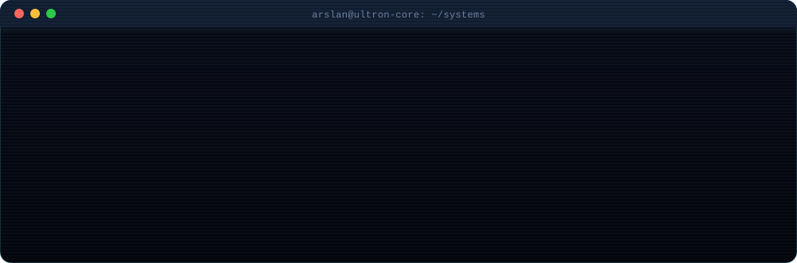

<p align="center">
  
</p>

<p align="center">
  
</p>

<p align="center">
  <a href="https://www.linkedin.com/in/arslan-farooqui-7734a126b"></a>
  <a href="mailto:arslanfarooqui784@gmail.com"></a>
  <a href="https://xyx-anatomy.netlify.app"></a>
  
</p>

<p align="center"></p>


```yaml
> whoami
name:     Arslan Farooqui
role:     AI Engineer — agentic systems, LLM applications, Android + web
base:     B.Tech, Civil Engineering (NEFTU, 2025)
building: ULTRON · XYX Anatomy · Hamza Shoe Center
learning: Python · DSA · Machine Learning · open source (GSoC 2027)
motto:    ship real software that real people use
```


## ⟁ Featured systems

<a href="https://github.com/arslanfarooqui784-tech/ultron"></a>

**🔴 ULTRON — personal AI agent** · `Java` `Android` `Python` `LLM APIs` `TTS / STT`
A voice-controlled AI assistant running as a native Android app and a Windows server that pair over Wi-Fi. Multi-model routing across **Gemini, Claude, GPT, Grok and Groq** with a local **Ollama** fallback, a messaging agent for **6 channels** under a **3-tier human-in-the-loop** approval policy, plus calls, routines, a daily briefing and a custom voice. **30 Java classes · ~11k lines · 28 releases** · [**Repo →**](https://github.com/arslanfarooqui784-tech/ultron)

<br>

<a href="https://github.com/arslanfarooqui784-tech/xyx-anatomy"></a>

**🧬 XYX Anatomy — 3D anatomy atlas** · `JavaScript` `WebGL` `PWA` `Ontologies`
A browser-based 3D human anatomy atlas with **2,457** selectable structures (male 935 · female 1,522) built on **BodyParts3D, HuBMAP, Uberon, Mondo, Cell and Gene ontologies** — layer peeling, X-ray, cross-sections, a CT/MRI slice explorer and auto-generated quizzes. [**▶ Live app**](https://xyx-anatomy.netlify.app) · [**Repo →**](https://github.com/arslanfarooqui784-tech/xyx-anatomy)

<br>

<a href="https://github.com/arslanfarooqui784-tech/hamza-shoe-center"></a>

**👟 Hamza Shoe Center — retail OS in daily production** · `JavaScript` `PWA` `Offline-first` `Android`
An offline, bilingual (Hindi/Hinglish) business app running a real footwear shop: billing with split payments, size-wise inventory, customer credit, supplier ledgers, PIN-based roles, an audit log, reorder recommendations and profit-and-loss reports. [**▶ Live app**](https://hamza-shoe-center-app.netlify.app) · [**Repo →**](https://github.com/arslanfarooqui784-tech/hamza-shoe-center)


## ⟁ Tech stack

<p align="center"></p>

<p align="center">
  
</p>

<p align="center">
  
  
  
  
  
</p>


## ⟁ Telemetry

<p align="center">
  
  
</p>
<p align="center">
  
</p>


<p align="center"></p>

<p align="center">
  <sub><code>SYS://ARSLAN.FAROOQUI</code> · building in public · open to AI/ML, GenAI and software engineering internships</sub>
</p>
